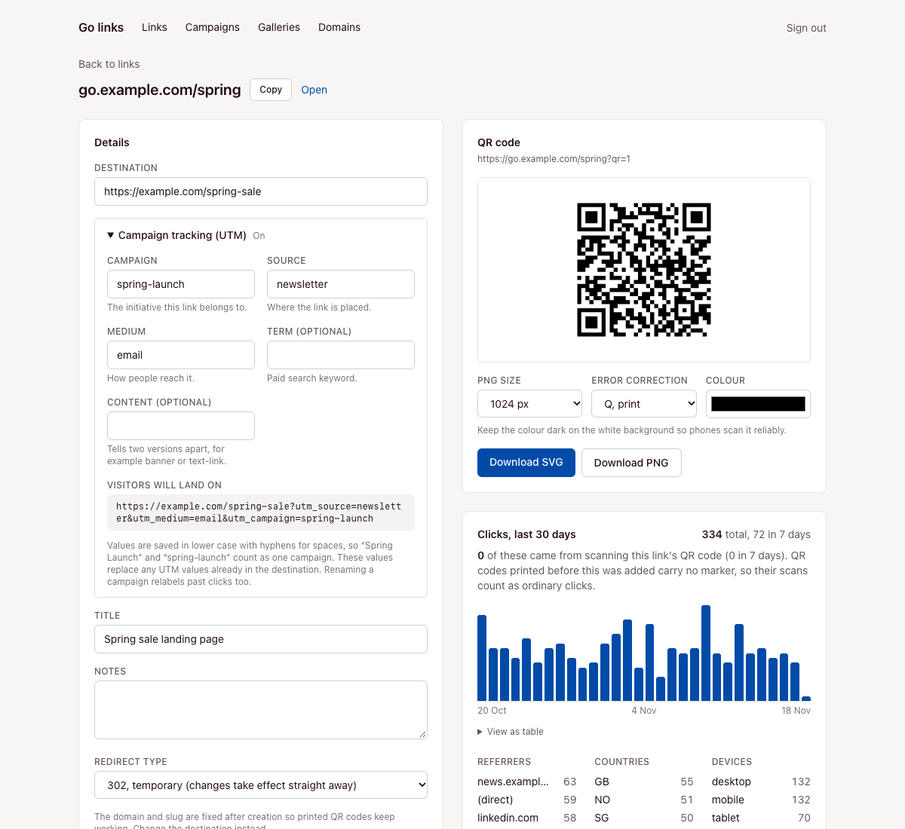
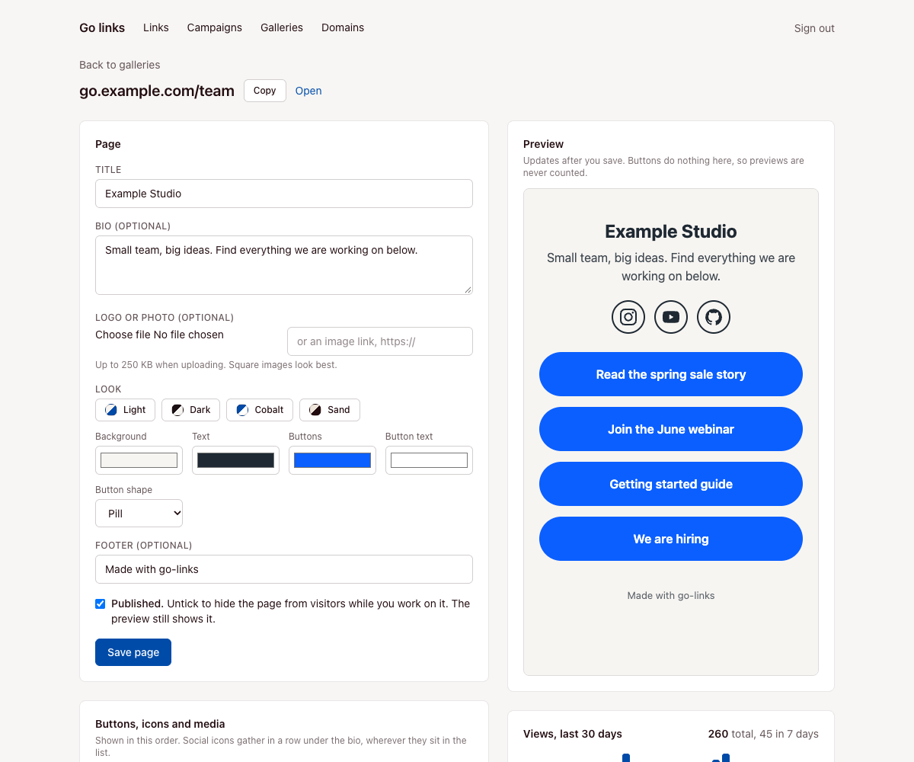

# opengolinks

A small multi-domain link shortener with QR codes, link-in-bio galleries, UTM tagging and click statistics, built with Next.js and Postgres. It was built with Claude, and it is published as a readable reference that you can fork and adapt, not as a product.

## Features

- **Multi-domain.** One app serves any number of domains, such as `go.example.com` and `go.example.org`. It decides what to do from the Host header, so the same slug can point to different places on different domains.
- **Slugs.** Choose your own or let the app generate one. The domain and slug are fixed after creation so printed QR codes keep working; the destination can change at any time.
- **QR codes.** For every link and gallery, as SVG or PNG (512 to 4096 px), with error correction level and colour options. Codes downloaded from the app carry a `?qr=1` marker, so scans are counted apart from clicks.
- **Galleries.** A small branded page at a slug (`go.example.com/team`) with a title, bio, picture, buttons, social icons, images and a YouTube video. Colours and button shape are adjustable, and each button click is counted.
- **UTM builder.** Optional `utm_*` fields on each link, with a live preview. The values are added at redirect time, so the stored destination stays clean. A Campaigns page groups clicks by campaign and by source and medium.
- **Click statistics.** Totals, a 30 day chart, referrers, countries and devices. Bots and link preview crawlers are excluded.
- **Domain icons.** Each domain shows its icon in the admin, fetched from its main website, with a two-letter mark when none is found.
- **Per-domain fallbacks.** A redirect for the bare domain and one for unknown slugs. New domains start with both pointing at the main website (`go.example.com` goes to `example.com`).
- **Import.** Bring links in from a CSV file, or from an existing account through its API, with a preview before anything is saved. See [Importing links](#importing-links).
- **People and roles.** Teammates sign in with their own account (GitHub, Google or Microsoft 365) and are admins or members. Admins invite people from the admin by email or link, and can remove them at any time. See [People and sign-in](#people-and-sign-in).
- **AI agents.** The app is also an MCP server, so Claude or any other MCP-capable agent can create links, fetch QR codes and read results, signed in as a person and with that person's permissions. It can never delete anything. See [Connecting an AI agent](#connecting-an-ai-agent-mcp).
- **Domain checks.** The Domains page tells you whether each domain really reaches the app, and what to do if not.

## Screenshots

All taken with demo data on `example.com`.

| Links | Link detail |
| --- | --- |
|  |  |

| Campaigns | Gallery editor |
| --- | --- |
|  |  |

A published gallery:


## What you need to set up

The code is only half of it. To run your own copy you need to bring these. Nothing here is done for you, and the app cannot do it on your behalf.

| You need | Why | Where to read more |
| --- | --- | --- |
| **A host that runs Node.js 22 or later** | The app is a Next.js server. Vercel, Netlify, Railway, Render, Fly.io, your own server and others can run it, with different caveats. | [docs/deploy.md](docs/deploy.md) |
| **A Postgres database** | Links, clicks, accounts and settings live there. Neon, Supabase, your host's Postgres or your own server all work. Back it up. | [Configuration](#configuration) |
| **Environment variables** | `DATABASE_URL`, `SESSION_SECRET`, `ADMIN_HOSTS` and `ADMIN_EMAILS` at least. The app refuses to start in production if the essentials are wrong. | [Configuration](#configuration) |
| **A way to sign in** | Create a GitHub OAuth app, a Google OAuth client or a Microsoft Entra app registration (or, only to get started, set `ADMIN_PASSWORD`). Only you can create these, because they are tied to your callback address. | [docs/auth.md](docs/auth.md) |
| **A domain for the admin** | The host in `ADMIN_HOSTS`, with HTTPS, attached to your host. `/admin` answers only there. | [docs/deploy.md](docs/deploy.md) |
| **Your short-link domains** | For each one: a DNS record, the domain attached to your host with a certificate, and the domain added on the Domains page. | [Adding a domain](#adding-a-domain) |
| **Optional: invitation email** | Needs a Microsoft 365 mailbox and a Graph permission. Without it, invitations give you a link to send yourself. | [docs/auth.md](docs/auth.md) |
| **Optional: a time zone and a name** | `TIMEZONE` decides where a day starts in the statistics; `APP_NAME` renames the app. | [Configuration](#configuration) |

Things you are responsible for once it is running: database backups, keeping Next.js and the dependencies up to date, a rate limit in front of public traffic if you expect abuse, and who you invite. The [Limitations](#limitations) section lists what the app does not protect you from.

The shortest path, once you have a host and a database: set the four variables and one sign-in method, deploy, sign in with the account in `ADMIN_EMAILS`, add a domain, create a link.

## Quick start

Requires Node 22 or later.

```bash
npm install
cp .env.example .env     # set ADMIN_PASSWORD to anything for local use
npm run dev
```

With `DATABASE_URL` empty, an embedded Postgres (PGlite) is created in `.data/`, so there is nothing else to set up. Open http://localhost:3000/admin, sign in, add the domain `localhost` on the Domains page, then create links.

To try another host locally: `curl -H "Host: go.example.com" http://localhost:3000/slug`

In development the app warns about settings that would be refused in production, and a missing `SESSION_SECRET` falls back to a fixed development value. Locally you can sign in with `ADMIN_PASSWORD`; in production, use a provider and treat the shared password as temporary.

Run the unit tests with `npm test` (Node 22.6 or later).

## Configuration

Set these in `.env` locally, or in your host's environment settings. `.env.example` lists them all.

| Variable | Purpose | Default | Required in production |
| --- | --- | --- | --- |
| `DATABASE_URL` | Postgres connection string, for any Postgres. Certificates are verified; use `sslmode=no-verify` in the string only for a self-signed server. | embedded database in `.data/` (development only) | Yes |
| `DATABASE_URL_POOLED` | A pooled connection string. Wins over `DATABASE_URL` when set. | none | No |
| `PGLITE_DIR` | Directory for the embedded database. Lets a production build run locally without `DATABASE_URL`. | none | No |
| `SESSION_SECRET` | Signs the session cookie. Generate with `openssl rand -hex 32`. | none | Yes, at least 32 characters |
| `ADMIN_HOSTS` | Comma separated hosts allowed to serve `/admin`. The first is also used for sign-in redirects and as the default CNAME target. | empty: open in development | Yes, otherwise `/admin` answers 404 on every host |
| `ADMIN_EMAILS` | Comma separated emails that are always admins (created at startup if missing). This is how the first person gets in. | none | Yes, unless you use `ADMIN_PASSWORD` |
| `ADMIN_PASSWORD` | A shared password for `/admin`. It is not tied to a person and counts as an admin, so use it to get started and then remove it. | none | No. Without it, set a sign-in provider |
| `GITHUB_CLIENT_ID`, `GITHUB_CLIENT_SECRET` | Enable "Continue with GitHub". | none | No |
| `GOOGLE_CLIENT_ID`, `GOOGLE_CLIENT_SECRET` | Enable "Continue with Google". | none | No |
| `MICROSOFT_TENANT_ID`, `MICROSOFT_CLIENT_ID`, `MICROSOFT_CLIENT_SECRET` | Enable "Continue with Microsoft 365" for one tenant. | none | No |
| `MAIL_FROM` | The Microsoft 365 mailbox that sends invitation emails (needs the three Microsoft settings and the `Mail.Send` permission). Without it, invitations give you a link to send yourself. | none | No |
| `CNAME_TARGET` | Host shown as the CNAME value on the Domains page. | first `ADMIN_HOSTS` entry | No |
| `APP_NAME` | The name shown in the admin, in invitation emails and to AI agents. | `opengolinks` | No |
| `TIMEZONE` | IANA time zone that decides where a day starts in the statistics, for example `Europe/London`. | `UTC` | No |
| `REBRANDLY_API_BASE` | Test only: the base URL the Rebrandly importer calls, so tests can use a local fake. Leave it unset. | `https://api.rebrandly.com` | No |

In production the server refuses to start (it prints what is wrong and exits) if `SESSION_SECRET` is missing or too short, if `ADMIN_PASSWORD` is set but shorter than 12 characters, or if there is no way to sign in (no provider and no password). It warns about a mistyped Microsoft setting, and when nobody could sign in because `ADMIN_EMAILS` is empty. A missing `DATABASE_URL` makes the first request fail with a clear message in the logs.

## Deployment

Any host that runs a Node.js server (or runs Next.js for you) and can reach a Postgres database will do. **[docs/deploy.md](docs/deploy.md) explains what the app needs from a host and how to set it up on Vercel, Netlify, Cloudflare, Railway, Render, Fly.io, or a server of your own**, including what does and does not work on each.

| Platform | Fit |
| --- | --- |
| Vercel | Expected to work. External Postgres, pooled connection. |
| Netlify | Expected to work. Country statistics show as Unknown. |
| Cloudflare Workers | Not supported as it stands. Cloudflare as DNS and proxy in front of another host works well. |
| Railway, Render, Fly.io | Expected to work. They run a plain Node server. |
| Your own server or Docker | Expected to work. Put a reverse proxy such as Caddy in front. |
| Managed Node.js hosting with parked domains | Works. |

"Expected to work" means the app has no known obstacle there, but it has not been deployed to that platform by the author.

The generic recipe:

1. Create a Postgres database and set `DATABASE_URL`.
2. Set `SESSION_SECRET`, `ADMIN_HOSTS`, `ADMIN_EMAILS` and a sign-in method as in the table above.
3. Build and start: `npm ci`, `npm run build`, then `npm start` (Node 22 or later). Set `PORT` if your host needs one.
4. Put a reverse proxy or platform router in front that forwards the original Host header, or sets `X-Forwarded-Host` (the last entry is used). Terminate HTTPS there.
5. Tables are created automatically on the first request. `schema.sql` is a copy of the schema (the app itself uses `src/lib/schema.ts`; keep the two in sync).

### Adding a domain

Each extra domain needs, once:

1. A DNS record at the domain's DNS provider, typically a CNAME from `go.example.com` to your admin host (or to the target your platform shows; set `CNAME_TARGET` so the Domains page displays it). A domain with no subdomain cannot normally use a CNAME: use an ALIAS or ANAME record if your DNS provider has one, or use a subdomain.
2. The domain attached to your host, so requests for it reach the app and it gets a certificate. Platforms call this a custom domain, alias or parked domain. How depends on your host: see [docs/deploy.md](docs/deploy.md).
3. The domain added on the app's Domains page. This step is manual. The page shows what is left to do and checks whether the domain reaches the app.

Every domain serves the same links table, scoped by host. The admin area answers only on the hosts in `ADMIN_HOSTS`.

**How "live" is checked.** The server probes each domain's addresses itself (`https://<domain>/api/ping`), but a server often cannot reach its own public addresses, and some DNS setups (an ALIAS, or a flattened CNAME) answer with different addresses depending on who asks. So a failure on the server is not taken as proof. The admin's own browser, which is in the same position as a visitor, is asked as well: if the browser reaches the domain, the card shows it as reachable and stops listing it first, and only if the browser cannot reach it either are the next steps shown. Each card also lists what the server saw at every address.

## People and sign-in

Everyone signs in as themselves, and is an **admin** or a **member**. Members work with links, QR codes, galleries and campaigns; admins also manage people, domains and imports. Admins invite people from the **People** page: an invitation is a single-use link, tied to the invited email address and valid for 7 days, emailed through Microsoft 365 if you set that up and otherwise given to you to send.

- **Sign-in options:** GitHub, Google and Microsoft 365 (one tenant). Each is switched on by its environment variables, and an address only counts when the provider says it is **verified**. Nobody without an account or an invitation gets in, whatever the provider says.
- **First admin:** list your email in `ADMIN_EMAILS`. Those accounts are always admins and cannot be demoted or removed on the People page.
- **Shared password:** `ADMIN_PASSWORD` works only while it is set. It counts as an admin and is not tied to a person, so remove it once everyone has an account. **Settings** (admins only) reports which options are on and flags a mistyped setting.
- Removing a person or changing their role applies on their next request, and removing them also ends their AI agent connections.

How to create each provider's app, the invitation email, and how to retire the password are in [docs/auth.md](docs/auth.md).

## Connecting an AI agent (MCP)

The app is also an MCP server at `/api/mcp`. An AI agent that supports remote MCP servers (Claude, Cursor, VS Code, Gemini CLI and others) can search links, create them, change destinations, fetch QR codes, read campaign results and, for admins, add domains. The agent signs in as a person through your own sign-in and approves each connection on a consent page, and everything it does is limited to that person's role. **Admin, then Connected apps** shows the server address, copy-paste setup for common agents, and lets you disconnect an agent.

Nothing can delete a link, gallery or domain through it, and a link's domain and slug cannot be changed, so printed QR codes keep working. The tool list, the sign-in flow, the security notes and troubleshooting are in [docs/mcp.md](docs/mcp.md).

## Importing links

Admin, Import brings existing links in from a CSV file or from Rebrandly. Both sources follow the same rules:

- **Preview first.** "Preview only" is ticked by default. A preview reads everything and applies the rules, then reports what would happen and saves nothing. Check the report, then untick the box and import.
- **Domains must be added first.** Each domain has to be on the Domains page. Links on any other domain are not imported, and the report says which.
- **Safe to run again.** A link whose domain and slug already exist is never changed or duplicated. If it exists with a different destination, it is listed and left alone.
- **Slugs are lower-cased.** Slugs this app does not support (other characters, over 64 characters, reserved words), entries that differ only by capital letters, slugs a gallery already uses, and destinations that are not http or https are listed as skipped.
- **Links keep their domain and slug**, so printed QR codes keep working once the domain's DNS points here. Import before switching a domain's DNS.
- **Click history does not come across.** Statistics start from zero for imported links.

### Importing from a CSV file

The first row names the columns. Commas and semicolons both work as separators, and the file should be UTF-8.

| Column | Required | Notes |
| --- | --- | --- |
| `domain` | Yes | A domain already added on the Domains page. |
| `slug` | Yes | Letters, numbers, hyphens and underscores, up to 64 characters. |
| `destination` | Yes | A full `http://` or `https://` address. |
| `title` | No | |
| `utm_source`, `utm_medium`, `utm_campaign`, `utm_term`, `utm_content` | No | Saved as the link's campaign fields, in lower case. |

```csv
domain,slug,destination,title,utm_source,utm_medium,utm_campaign
go.example.com,spring,https://example.com/spring-sale,Spring sale,newsletter,email,spring-launch
```

- Other columns are ignored, and the report names them. Blank rows are skipped, and the row numbers in the report match the row numbers in a spreadsheet.
- A file may be up to 1 MB or 20,000 rows. Links are saved in batches of 100. A file over either limit is refused with a message and nothing is imported, so split it and import the parts one at a time.
- The file is read for that request and is not kept.

### Importing from Rebrandly

Paste a Rebrandly API key. A key covers one workspace, so repeat the import with each workspace's key, adding the workspace ID if it is not the key's default.

- **The key is used once and never stored.** It is sent to Rebrandly for that request only, and it is not saved or logged.
- `utm_` values in a destination can be moved into the campaign fields (on by default, saved in lower case).
- Title and creation date are kept. A note on each link records where it came from and Rebrandly's click total.
- Rebrandly's documentation disagrees on the page size (25 or 100), so the importer asks for 100 and falls back to 25. It stops at 20,000 links; run it again once that batch is imported.
- The importer has been run against the real Rebrandly API. `REBRANDLY_API_BASE` exists only so tests can point it at a local fake. Leave it unset.

## How it works

- **Redirects** use 302 by default so edits take effect immediately. 301 is available per link, but browsers cache it.
- **UTM values** are lower-cased with hyphens for spaces, limited to 100 characters and URL-encoded. A link's own values replace any `utm_` values already in the destination, other query parameters keep their exact encoding, and a `#fragment` is kept.
- **Gallery pages** are plain HTML with no scripts, served with a strict Content-Security-Policy. Addresses, colours and images are checked on save and again when rendering, so only `http(s)` links, `mailto:`, hex colours, https or small data images (uploads are limited to 250 KB) and YouTube embeds can reach the page. Button clicks go through `/<gallery slug>/<item id>`, which records the click and redirects. A gallery and a link cannot share a slug on one domain.
- **Slugs** are stored lower case and matched case-insensitively. Reserved: `admin`, `api`, `login`, `logout`, `robots.txt`, `sitemap.xml`, `favicon.ico`.
- **Country** comes from the `x-vercel-ip-country` or `cf-ipcountry` header, and only a two-letter code is stored. On other hosts it shows as Unknown unless a proxy in front sets one of those headers. Without such a proxy, any client can send the header, so treat country figures as unreliable there.
- **Security headers.** `/admin` and `/api` send `X-Content-Type-Options`, `Referrer-Policy` and `X-Frame-Options: DENY` (the gallery preview, which the admin area embeds, allows framing by the same site only).
- **Domain icons.** When a domain is added, the app fetches an icon from its main website (for `go.example.com` it tries `example.com`, then the host itself) and stores it in the database. The Domains page has a Fetch icon button, and domains without an icon are retried weekly. The fetch is limited to public HTTPS sites: the name must resolve to public IPv4 addresses, the connection is pinned to the address that was checked, at most three redirects are followed with each hop checked again, and the whole request is time limited and size capped. An icon is accepted only when its bytes are a small PNG, JPEG, GIF, WebP or ICO image, or a plain SVG with no script, event handlers or external references, whatever type the site claims. It is served only to signed-in admins, with a restrictive Content-Security-Policy.
- **Sign-in security.** Provider sign-in uses a state value, PKCE (Google, Microsoft) and a nonce (Microsoft), kept in short-lived httpOnly cookies, and accepts only a provider's *verified* email address. Microsoft sign-in is for one tenant, and the token's tenant, app, nonce and expiry are checked. A page to return to after signing in is accepted only inside `/admin`. Invitation links hold a random token whose hash is stored, are single use, and only work for the invited address.
- **AI agent access.** The MCP endpoint is its own small OAuth server: dynamic client registration for public clients, authorization code with PKCE (required), a consent page, tokens stored as hashes, one-hour access tokens and rotating refresh tokens, redirect addresses matched exactly, and rate limits on registration, token and MCP calls. It answers only on the hosts in `ADMIN_HOSTS`. Details in [docs/mcp.md](docs/mcp.md).
- **Login throttling.** Password attempts are counted in the database before the password is checked: 5 per client and 40 in total per 15 minutes, after which the form refuses attempts until the window passes. The count survives restarts and is shared between instances. A wrong password also has a short delay.

## Limitations

This is a reference build. Know what it does not do before you run it.

- **Two roles, no audit log.** People are admins or members, and that is all: no teams, no per-link permissions, and no record of who changed what. Every member can edit or delete any link or gallery.
- **The shared password is weak by design.** If `ADMIN_PASSWORD` is set, anyone who knows it is an admin and nothing they do is tied to a person. Remove it once people have their own accounts.
- **No destination screening or abuse protection.** Anything an admin enters is redirected to, and short links on your own domain are a well-known phishing vector. Run it privately, for people you trust, and do not offer public link creation.
- **Login throttling is simple.** The per-client count keys on the last `X-Forwarded-For` entry. If your proxy does not set that header, every client shares one key, and the overall limit is what protects you. Someone hammering the form can use up the overall allowance and block password sign-in for up to 15 minutes.
- **Few automated tests.** `npm test` runs unit tests for the sign-in, OAuth, invitation-email and domain-check logic. The rest (pages, redirects, imports) has been checked by hand.
- **Invitation email is Microsoft 365 only.** For any other mail provider, invitations give you a link to send yourself.
- **AI agent permissions are all or nothing.** An agent can do whatever its person can through the tools (apart from deleting, which no tool does). There are no per-tool permissions. Anything a tool returns, such as a link title written by a colleague, is data the agent reads, which is the usual prompt-injection exposure of any MCP server.
- **Country needs a proxy header** (see above).
- **Outbound requests.** The Domains page makes a DNS lookup and an HTTPS request to each domain an admin adds, to show its status, and the app fetches an icon from each domain's main website when the domain is added and then weekly while none has been found. The Rebrandly importer sends the API key you give it to `api.rebrandly.com` for the duration of one import. Signing in calls the provider you chose, and invitation email calls Microsoft's Graph API.
- **No limit on public traffic.** Every visit to a short link or gallery writes one row, and nothing rate-limits that. Put a rate limit in front if the domain is exposed to untrusted traffic.
- **Click logging** runs after the redirect and is best effort. A failed write is logged and the visitor is still redirected.

## Support

This is a reference project with no support. Issues and pull requests are welcome but may go unanswered. Fork it and make it yours. To report a security problem, see [SECURITY.md](SECURITY.md).

## Licence

MIT. See [LICENSE](LICENSE). Copyright (c) 2026 Erik Ingvoldstad. The social icons are from the Simple Icons project (CC0).
