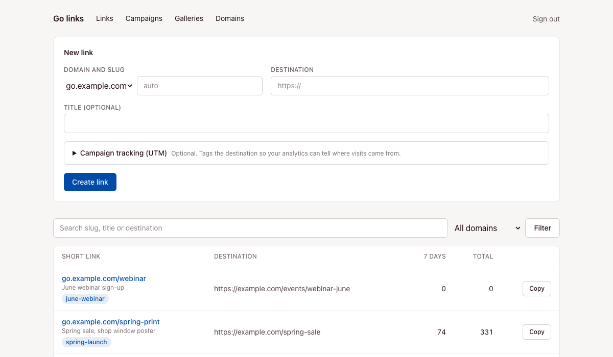
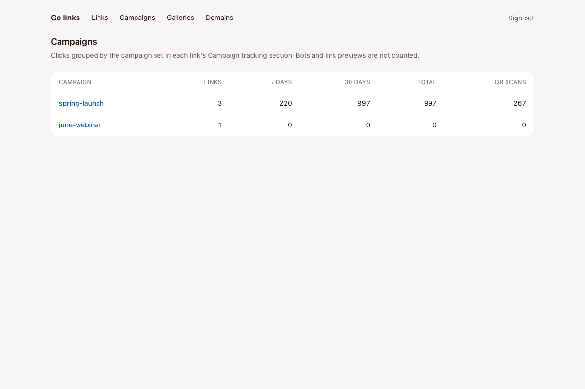
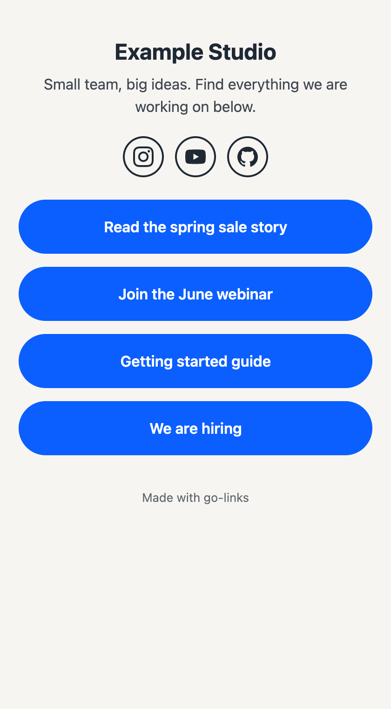

# opengolinks

A small multi-domain link shortener with QR codes, link-in-bio galleries, UTM tagging and click statistics, built with Next.js and Postgres. It was built with Claude, and it is published as a readable reference that you can fork and adapt, not as a product.

## Features

- **Multi-domain.** One app serves any number of domains, such as `go.example.com` and `go.example.org`. It decides what to do from the Host header, so the same slug can point to different places on different domains.
- **Slugs.** Choose your own or let the app generate one. The domain and slug are fixed after creation so printed QR codes keep working; the destination can change at any time.
- **QR codes.** For every link and gallery, as SVG or PNG (512 to 4096 px), with error correction level and colour options. Codes downloaded from the app carry a `?qr=1` marker, so scans are counted apart from clicks.
- **Galleries.** A small branded page at a slug (`go.example.com/team`) with a title, bio, picture, buttons, social icons, images and a YouTube video. Colours and button shape are adjustable, and each button click is counted.
- **UTM builder.** Optional `utm_*` fields on each link, with a live preview. The values are added at redirect time, so the stored destination stays clean. A Campaigns page groups clicks by campaign and by source and medium.
- **Click statistics.** Totals, a 30 day chart, referrers, countries and devices. Bots and link preview crawlers are excluded.
- **Per-domain fallbacks.** A redirect for the bare domain and one for unknown slugs. New domains start with both pointing at the main website (`go.example.com` goes to `example.com`).
- **Admin.** A single shared password at `/admin`, with optional GitHub sign-in for listed email addresses.

## Screenshots

All taken with demo data on `example.com`.

| Links | Link detail |
| --- | --- |
|  |  |

| Campaigns | Gallery editor |
| --- | --- |
|  |  |

A published gallery:



## Quick start

Requires Node 22 or later.

```bash
npm install
cp .env.example .env     # set ADMIN_PASSWORD to anything for local use
npm run dev
```

With `DATABASE_URL` empty, an embedded Postgres (PGlite) is created in `.data/`, so there is nothing else to set up. Open http://localhost:3000/admin, sign in, add the domain `localhost` on the Domains page, then create links.

To try another host locally: `curl -H "Host: go.example.com" http://localhost:3000/slug`

In development the app warns if `ADMIN_PASSWORD` or `SESSION_SECRET` would be refused in production, and a missing `SESSION_SECRET` falls back to a fixed development value.

## Configuration

Set these in `.env` locally, or in your host's environment settings. `.env.example` lists them all.

| Variable | Purpose | Default | Required in production |
| --- | --- | --- | --- |
| `DATABASE_URL` | Postgres connection string, for any Postgres. Certificates are verified; use `sslmode=no-verify` in the string only for a self-signed server. | embedded database in `.data/` (development only) | Yes |
| `DATABASE_URL_POOLED` | A pooled connection string. Wins over `DATABASE_URL` when set. | none | No |
| `PGLITE_DIR` | Directory for the embedded database. Lets a production build run locally without `DATABASE_URL`. | none | No |
| `ADMIN_PASSWORD` | Password for `/admin`. | none | Yes, at least 12 characters |
| `SESSION_SECRET` | Signs the session cookie. Generate with `openssl rand -hex 32`. | none | Yes, at least 32 characters |
| `ADMIN_HOSTS` | Comma separated hosts allowed to serve `/admin`. The first is also used for sign-in redirects and as the default CNAME target. | empty: open in development | Yes, otherwise `/admin` answers 404 on every host |
| `ADMIN_EMAILS` | Comma separated emails that get an account (created at startup if missing), used for GitHub sign-in. | none | No |
| `GITHUB_CLIENT_ID`, `GITHUB_CLIENT_SECRET` | Enable "Continue with GitHub". | none | No |
| `CNAME_TARGET` | Host shown as the CNAME value on the Domains page. | first `ADMIN_HOSTS` entry | No |
| `TIMEZONE` | IANA time zone that decides where a day starts in the statistics, for example `Europe/London`. | `UTC` | No |

In production the server refuses to start (it prints what is wrong and exits) if `ADMIN_PASSWORD` or `SESSION_SECRET` is missing or too short. A missing `DATABASE_URL` makes the first request fail with a clear message in the logs.

## Deployment

Any host that runs a Node.js server and a Postgres database will do.

1. Create a Postgres database and set `DATABASE_URL`.
2. Set `ADMIN_PASSWORD`, `SESSION_SECRET` and `ADMIN_HOSTS` as in the table above.
3. Build and start: `npm ci`, `npm run build`, then `npm start` (Node 22 or later). Set `PORT` if your host needs one.
4. Put a reverse proxy or platform router in front that forwards the original Host header, or sets `X-Forwarded-Host` (the last entry is used). Terminate HTTPS there.
5. Tables are created automatically on the first request. `schema.sql` is a copy of the schema (the app itself uses `src/lib/schema.ts`; keep the two in sync).

Each extra domain needs, once:

1. A DNS record, typically a CNAME from `go.example.com` to your admin host.
2. A certificate for it. How depends on your host or proxy.
3. The domain added on the app's Domains page. This step is manual. The page shows the record to create and checks whether `https://<domain>/api/ping` reaches the app.

Every domain serves the same links table, scoped by host. The admin area answers only on the hosts in `ADMIN_HOSTS`.

If you use GitHub sign-in, create an OAuth App with the callback URL `https://<admin host>/api/auth/github/callback`. GitHub allows one callback per app, so keep `ADMIN_HOSTS` to the host that callback points at. Sign-in only works for verified GitHub emails that match a row in the `users` table.

## How it works

- **Redirects** use 302 by default so edits take effect immediately. 301 is available per link, but browsers cache it.
- **UTM values** are lower-cased with hyphens for spaces, limited to 100 characters and URL-encoded. A link's own values replace any `utm_` values already in the destination, other query parameters keep their exact encoding, and a `#fragment` is kept.
- **Gallery pages** are plain HTML with no scripts, served with a strict Content-Security-Policy. Addresses, colours and images are checked on save and again when rendering, so only `http(s)` links, `mailto:`, hex colours, https or small data images (uploads are limited to 250 KB) and YouTube embeds can reach the page. Button clicks go through `/<gallery slug>/<item id>`, which records the click and redirects. A gallery and a link cannot share a slug on one domain.
- **Slugs** are stored lower case and matched case-insensitively. Reserved: `admin`, `api`, `login`, `logout`, `robots.txt`, `sitemap.xml`, `favicon.ico`.
- **Country** comes from the `x-vercel-ip-country` or `cf-ipcountry` header, and only a two-letter code is stored. On other hosts it shows as Unknown unless a proxy in front sets one of those headers. Without such a proxy, any client can send the header, so treat country figures as unreliable there.- **Security headers.** `/admin` and `/api` send `X-Content-Type-Options`, `Referrer-Policy` and `X-Frame-Options: DENY` (the gallery preview, which the admin area embeds, allows framing by the same site only).
- **Login throttling.** Password attempts are counted in the database before the password is checked: 5 per client and 40 in total per 15 minutes, after which the form refuses attempts until the window passes. The count survives restarts and is shared between instances. A wrong password also has a short delay.

## Limitations

This is a reference build. Know what it does not do before you run it.

- **Single admin identity.** One shared password, plus optional GitHub sign-in for listed emails. There are no roles, teams or audit log.
- **No destination screening or abuse protection.** Anything an admin enters is redirected to, and short links on your own domain are a well-known phishing vector. Run it privately, for people you trust, and do not offer public link creation.
- **Login throttling is simple.** The per-client count keys on the last `X-Forwarded-For` entry. If your proxy does not set that header, every client shares one key, and the overall limit is what protects you. Someone hammering the form can use up the overall allowance and block password sign-in for up to 15 minutes.
- **No automated tests.** Behaviour has been checked by hand.
- **Country needs a proxy header** (see above).
- **Outbound requests.** The Domains page makes a DNS lookup and an HTTPS request to each domain an admin adds, to show its status.
- **No limit on public traffic.** Every visit to a short link or gallery writes one row, and nothing rate-limits that. Put a rate limit in front if the domain is exposed to untrusted traffic.
- **Click logging** runs after the redirect and is best effort. A failed write is logged and the visitor is still redirected.

## Support

This is a reference project with no support. Issues and pull requests are welcome but may go unanswered. Fork it and make it yours. To report a security problem, see [SECURITY.md](SECURITY.md).

## Licence

MIT. See [LICENSE](LICENSE). Copyright (c) 2026 Erik Ingvoldstad. The social icons are from the Simple Icons project (CC0).
